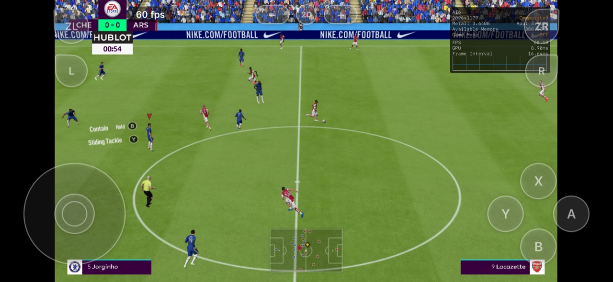
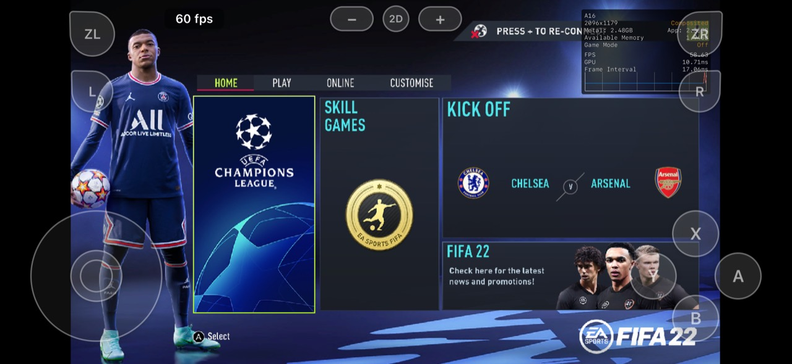
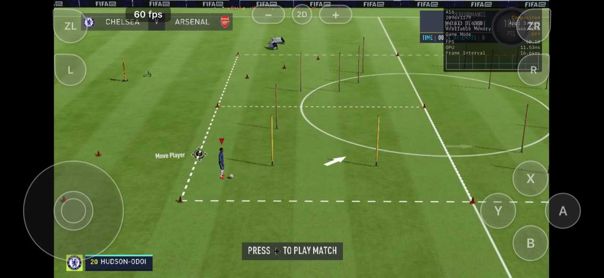

# nxnative — FIFA 22 / A16

A FIFA 22-focused fork of **nxnative**, with Apple A16 support, corrected texture rendering, and reduced graphics allocation overhead.

Built on [Jeb0978/nxnative-a16](https://github.com/Jeb0978/nxnative-a16), itself a fork of [seedds/nxnative](https://github.com/seedds/nxnative). nxnative runs the game's rewritten ARM64 code on Apple hardware and implements its system and graphics interfaces, translating graphics to Metal.

**Build directly with nxnative.** The command-line tools in this repository turn your own game files into an iOS application; no separate build frontend is required on macOS.

## Compatibility

| Component | Tested configuration |
| --- | --- |
| Game | FIFA 22 Legacy Edition base game + version 1.0.5 update (v327680) |
| Title ID | `0100216014472000` |
| Device | iPhone 15 — Apple A16 |
| Installation | LiveContainer |

**Reported performance on iPhone 15 (A16): 60 FPS during gameplay, 30 FPS during cutscenes, with little to no stuttering in the latest play sessions.** Pitch, stadium, and player textures render correctly. The screenshots below show the game running at 60 FPS.

The parent A16 fork also runs on macOS, as confirmed by its maintainer. This fork retains that engine and adds FIFA compatibility fixes and graphics allocation improvements; this exact FIFA configuration still needs a separate Mac build/play test.

**No commercial game files, ROMs, firmware, encryption keys, or prebuilt game IPAs are included.** This repository provides the engine, build tools, and compatibility profiles. You must supply your own lawfully obtained game files and keys.

## Screenshots

Captured on iPhone 15 (A16), running through LiveContainer.



| Main menu | Training |
| --- | --- |
|  |  |

## Improvements

- **FIFA shader extraction:** support for EA BIG4/BIGF archives and discovery of the game's GLSLC shaders.
- **Material rendering:** dynamic texture-handle support, corrected Metal argument-buffer layouts, and shader-cache invalidation when the lowering code changes.
- **A16 texture support:** software BC decoding with signed BC4/BC5, BC6H output-layout, and upload row-pitch/bounds corrections.
- **Texture synchronization:** CPU texture decoding waits for pending GPU writes to finish before reading their output, resolving corrupted surfaces and white player models.
- **Startup compatibility:** game-specific memory settings and command-buffer overflow handling, together with SDK/runtime compatibility fixes.
- **Lower allocation overhead:** texture lookup tables scale with the registered texture capacity instead of allocating the entire handle domain. A 2,048-entry table uses 16 KiB rather than 8 MiB, while preserving valid texture IDs and resource lifetimes.
- **Separate game data:** a small IPA can reuse an external `romfs.img` across app updates.

## Building

Supply the base game and matching 1.0.5 update in one game folder. The build uses the included [FIFA build profile](fifa-build-profile/0100216014472000), which provides the memory configuration and shader/pipeline tables required by this port.

### 1. Set up the tools

Use a Mac with [Xcode](https://developer.apple.com/xcode/) 27.1, Python 3.12 or newer, and the supporting build dependencies. The Metal compiler must also match the version recorded in [`dmsh_chain.lock`](dm/gfx/tools/dmsh_chain.lock); the Xcode version alone does not guarantee the exact compiler build. Check it with `python3 dm/gfx/tools/own_compilers.py --check-metal`, and follow the [upstream command-line setup](README.upstream.md#build-from-the-command-line), using this fork as your checkout.

### 2. Build your game

This NxNative Port Was paired with Nx2apple to make the BUILD.

From this repository's root:

```bash
python3 scripts/build_ipa_from_nsp.py /path/to/FIFA \
  -k /path/to/prod.keys \
  --profile-out "$PWD/fifa-build-profile" \
  --romfs separate \
  -o /path/to/FIFA22.ipa
```

To target a macOS application instead of an IPA, use `--platform mac-app`. See the compatibility section for platform testing status.

See [development documentation](docs/development.md) for additional build options and toolchain requirements. This repository contains source and tooling; it is not an iPhone app that can be installed without building and signing an IPA.

## Installation and game data

Sign and sideload the generated IPA using a compatible installation method. The tested setup uses LiveContainer with the increased-memory support required by the A16 port.

For `--romfs separate`, place the generated game image in the installed game's data container as `Documents/romfs.img`. When updating the same app, retain its data container to preserve the ROM, saves, and settings. An unchanged ROM image can be reused across engine and shader updates; changing the game version or extraction may require a new image.

See [playing documentation](docs/playing.md) for controls, saves, and settings.

## Validation

Validation included iOS shader compilation and argument-buffer layout checks, descriptor-index equivalence tests, texture synchronization regression tests, and IPA integrity checks. Relevant source tests include [descriptor bounds](dm/gfx/tests/test_raw_descriptor_bounds.py) and [BC source synchronization](dm/gfx/tests/test_bc_source_sync.py); each accepts a C compiler path.

Performance figures describe the tested device and game version, rather than a benchmark across all hardware. Device temperature, settings, and loading activity can affect results.

## Credits and license

- [Jeb0978/nxnative-a16](https://github.com/Jeb0978/nxnative-a16) — parent fork and Apple A16 support.
- [seedds/nxnative](https://github.com/seedds/nxnative) — native execution engine and build pipeline.
- [iOrange/bcdec](https://github.com/iOrange/bcdec) — software block-compression decoder.

Further acknowledgements are preserved in the [upstream README](README.upstream.md#acknowledgements). This project uses the [MIT license](LICENSE); bundled dependencies retain their [respective licenses](dm/third_party/README.md).

## Project notice

This is an independent community project. It is not affiliated with, sponsored by, or endorsed by Electronic Arts, Nintendo, FIFA, or Apple. Product names and trademarks belong to their respective owners and are used to identify compatibility. Gameplay screenshots document compatibility; the depicted game content remains the property of its respective rights holders.

The repository does not distribute commercial games, game executables, ROM images, firmware, encryption keys, or ready-to-play game IPAs, and does not provide download links to those materials. Do not submit them in issues, pull requests, or releases. Keep any locally generated game packages private unless you have the necessary rights to distribute their contents.

The source license applies to the project's code, subject to third-party licenses; it does not grant rights to game content or trademarks. Use and distribution must comply with applicable law. This notice is not a legal determination or a guarantee against claims.
